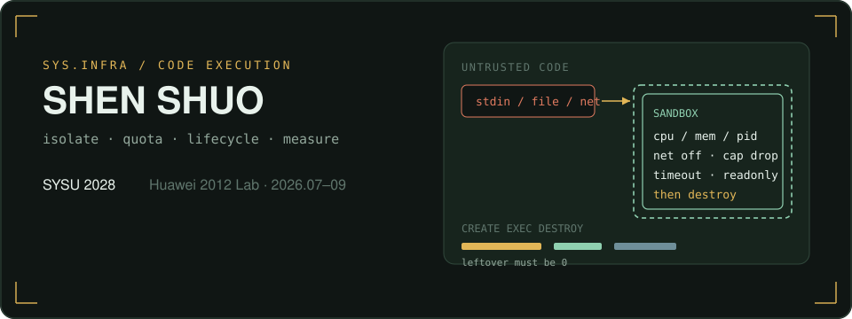
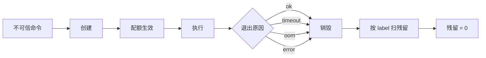
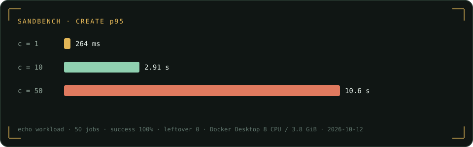

<p align="center">
  
</p>

<p align="center">
  <a href="https://github.com/shenshuo-maker/sandbench"></a>
  
  
  
</p>

给不可信代码一个短生命周期的执行环境。限制 CPU、内存、进程、网络和权限，跑完不留实例，把创建、执行、销毁三段时间分开记下来。

中山大学 · 信息管理与信息系统 · 2028 届  
华为 2012 实验室 · 代码执行沙箱 · 2026.07–09 · 杭州

主线是运行时，不是对话应用。检索、备案检测和两个业务演示都在下面，面试先看沙箱。

## 01  一条命令怎么穿过边界



| 层 | 要挡住什么 | 我实际用过的办法 |
| --- | --- | --- |
| 计算 | 打满 CPU、内存、进程 | cgroup 配额：`--cpus` `--memory` `--pids-limit`；实习里还有磁盘配额 |
| 网络 | 随便外连 | 公开对照是 `--network none`；实习里是 TAP 网络池，池耗尽会把创建打挂 |
| 权限 | 容器里再提权 | 非 root、`cap-drop ALL`、只读根、`no-new-privileges` |
| 时间 | 进程不退出 | 超时后杀掉，记成 `timeout`，不和 OOM 混在一张表里 |
| 回收 | 跑完还占着实例 | `docker rm -f`，结束再按 label 扫一遍 |

没做的写在这里，避免和做过的混在一起：没有 gVisor，没有 Kata，没有 Firecracker，没有实例池和排队调度。下一步才是把同步创建改成队列。

## 02  华为：离线 ARM 上把沙箱跑起来

环境是鲲鹏 ARM64 + openEuler，没有外网。上层要一个能隔离、能压测的代码执行环境。

先评估 E2B 的隔离、生命周期和执行接口。离线 ARM 上依赖缺失、架构和内核对不上，确认撑不住交付之后，切换到 Cube-Sandbox `v0.5.1-arm64`。然后才是落地，不是先写业务。

| 步骤 | 做了什么 | 看到什么 |
| --- | --- | --- |
| 选型 | E2B 与 Cube-Sandbox 对比，输出不能离线交付的结论 | 依赖、架构、内核三处同时卡住 |
| 落地 | 离线打包 rpm、Node 和容器依赖；打通运行时、TAP、权限 | CPU、内存、磁盘、网络配额和超时能限制单实例 |
| 内核 | OLK-6.6 适配，调 Zswap 和 KVM 参数 | ARM 上组件、Docker 网络、compose 多版本要逐个排 |
| 压测 | 自写脚本，创建 / 销毁 / 代码执行，梯度 50 / 500 | 网络池耗尽、实例残留、回收不及时、408 / 500 |
| 收口 | 逐项修完，留下性能基线 | 同一套 API 再验证执行、文件读写、销毁 |

旁边交过一块配套，不是主线：DeepSeek-Harness 上的公有知识库。管理员投放，普通用户只读，提问前检索，目录里新增文档后下次提问重建索引。TF-IDF 混合检索，补了单测和 CI，提交 PR `feat(rag): add a public shared-corpus knowledge base`。

实习仓库在内网。公开对照是下面的 sandbench，问题相同，边界更窄。

## 03  公开对照：sandbench

<p align="center">
  
</p>

[sandbench](https://github.com/shenshuo-maker/sandbench) 用 Docker + cgroup 跑一条命令，再压创建、执行、销毁。失败分成 `ok` / `timeout` / `oom` / `error`。`sleep 30` 配 2 秒超时记成 timeout；往 tmpfs 写爆内存、退出码 137 记成 oom。这两轮不放进上面那张延迟图。

| 并发 | jobs | 成功率 | 创建 p50 | 创建 p95 | 执行 p50 | 销毁 p50 | 残留 |
| --- | --- | --- | --- | --- | --- | --- | --- |
| 1 | 50 | 100% | 156 ms | 264 ms | 31 ms | 28 ms | 0 |
| 10 | 50 | 100% | 1988 ms | 2906 ms | 70 ms | 191 ms | 0 |
| 50 | 50 | 100% | 9101 ms | 10616 ms | 68 ms | 254 ms | 0 |

机器是 macOS arm64，Docker Desktop 29，虚拟机 8 CPU / 3.8 GiB，负载是 `echo`，日期 2026-10-12。创建时间包含 `docker run -d` 返回前的启动。并发拉到 50 时，`echo` 本身没变慢，慢在 dockerd 同时创建。这组和华为 50 / 500 不是同一次实验，不要加在一起讲。

```bash
python -m sandbench matrix --jobs 50 --concurrency 1,10,50 --workload ok
```

## 04  其余仓库

按离运行时的距离排。越往下，越不是这次求职要展开的部分。

| 仓库 | 它是什么 | 和沙箱的关系 |
| --- | --- | --- |
| [sandbench](https://github.com/shenshuo-maker/sandbench) | 隔离、超时 / OOM 分类、并发延迟、残留扫描 | 主线的公开实现 |
| [algorithm-check-system](https://github.com/shenshuo-maker/algorithm-check-system) | 算法备案文本合规检测。BERT、法规图谱、FastAPI。省级大创 | 另一条完整系统，不是运行时 |
| [smart-doc-platform](https://github.com/shenshuo-maker/smart-doc-platform) | 本地 PDF 切块、Chroma、ReAct 工具调用 | 检索练习，对应实习里那个知识库的形态 |
| [fin-research-ai](https://github.com/shenshuo-maker/fin-research-ai) | 科研辅助平台。Compose、JWT、AES-GCM、审计 | 只看部署和权限，不看业务 |
| [lead-flow-lite](https://github.com/shenshuo-maker/lead-flow-lite) | 获客演示。没有 Key 就走内置话术 | 应用项目，演示能不断 |

华数杯数学建模国家二等奖。编程和调度模型是那次比赛的事，不放进运行时主线。

## 05  联系

abc300739@qq.com · 19731188248

城市不限。看仓库从 [sandbench](https://github.com/shenshuo-maker/sandbench) 开始。
